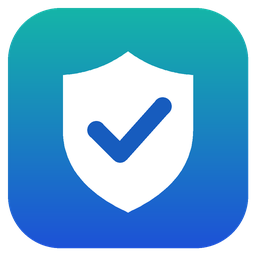
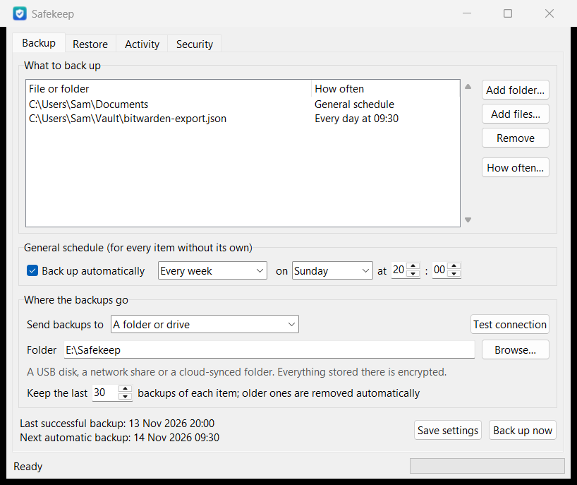
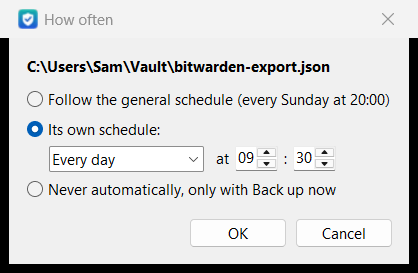
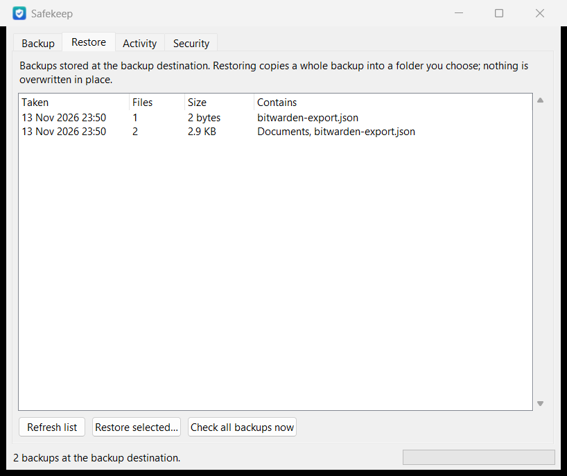

<p align="center"></p>

# Safekeep

Small automatic backups for Windows. You pick files and folders, how often
each should be backed up, and where the backups go: another computer over
SSH, or a folder such as a USB disk, a network share or a cloud-synced
folder. Everything is encrypted on your PC before it leaves, and what is
stored is re-checked regularly.

Windows starts each backup on schedule; nothing of Safekeep keeps running
in between. You hear from it only when a backup fails.



<p>


</p>

## Install

Download from the [latest release](https://github.com/karacanil/safekeep/releases/latest):

| File | Use it when |
| --- | --- |
| `Safekeep-x.y.z-setup.exe` | You want a normal install: Start menu entry, uninstaller, no administrator rights needed. |
| `Safekeep-x.y.z-windows-portable.zip` | You want no installer: unzip anywhere and run `Safekeep.exe`. |
| `SHA256SUMS.txt` | You want to check a download: `Get-FileHash <file>` must print the same value. |

The files are not code-signed yet, so Windows SmartScreen shows "Windows
protected your PC" on first start. Choose **More info**, then **Run anyway**.

Requirements: Windows 10 or 11 (64-bit). For an SSH destination, the other
computer needs `python3` and an SSH login that works without typing a
password (an SSH key); nothing is installed on it.

## Use

1. **Backup tab.** Add folders or files. Choose the general schedule, and
   where the backups go. Click **Save settings**, then **Back up now** once.
2. **A different rhythm for one item.** Select it and click **How often…**
   (or double-click it): follow the general schedule, have its own, or
   only back it up when you click **Back up now**.
3. **Security tab.** Save the recovery key somewhere that is neither this PC
   nor the backup destination. Without it the backups cannot be read if
   this PC or Windows account is lost.
4. **Restore tab.** Lists the stored backups; restore one into a folder you
   choose, or re-check everything that is stored.
5. **Activity tab.** What ran, when, and what went wrong if anything did.

### Where backups can go

| Destination | Set it up as | Notes |
| --- | --- | --- |
| Another computer on your network, by cable or Wi-Fi | Another computer (over SSH) | The SSH name is anything `ssh <name>` accepts, including entries in `~/.ssh/config`. |
| A computer elsewhere, over Tailscale, WireGuard or the internet | Another computer (over SSH) | Same as above; SSH encrypts the connection. |
| USB disk | A folder or drive | If the disk is not plugged in at backup time you get a notification. |
| NAS or network share | A folder or drive | Use the share's path, for example `\\nas\backups\safekeep`. |
| OneDrive, Dropbox, Google Drive and similar | A folder or drive | Point it at a folder the service syncs. The service only ever sees encrypted data. |

## How the backups are protected

| Threat | Protection |
| --- | --- |
| Someone reads the backup disk or account | Everything is AES-256-GCM encrypted on this PC before it is sent, file names included. The destination never has the key. |
| Disk damage at the destination | Every stored piece is named by the SHA-256 of its content and re-hashed every 7 days and on demand. Damaged pieces are reported and re-sent by the next backup. |
| Tampering at the destination | Changed data fails authentication. A backup put back under another name, or removed behind Safekeep's back, is reported. |
| Damage in transit | The receiving side refuses any piece whose hash does not match. |
| A file deleted or overwritten by mistake | Each run is a separate backup; the newest 30 of every item are kept (configurable). |
| A copy of the key file leaks | The key file is locked to your Windows account with DPAPI. |
| Power cut or pulled cable mid-backup | Pieces are written to a temporary file, synced, then renamed. A backup only appears once all its data is confirmed present. |

What it does not protect against is written down in [SECURITY.md](SECURITY.md).

## Command line

The installed app includes `safekeep-cli.exe`; from source use `python -m safekeep`.

```
safekeep-cli run                    back up everything now
safekeep-cli verify                 re-hash everything stored
safekeep-cli snapshots              list backups
safekeep-cli restore latest D:\restore-here
safekeep-cli schedule apply|remove|status
safekeep-cli key show|import <key>
safekeep-cli test                   test the connection
```

## Run from source

```
git clone https://github.com/karacanil/safekeep
cd safekeep
python -m venv .venv
.venv\Scripts\python -m pip install -r requirements.txt
.venv\Scripts\pythonw -m safekeep
```

Double-clicking `Safekeep.pyw` does the last step.

## Develop

```
.venv\Scripts\python -m pip install -r requirements-dev.txt
.venv\Scripts\python -m unittest discover -s tests
.venv\Scripts\python -m bandit -q -r safekeep -ll
.venv\Scripts\python -m PyInstaller --noconfirm --clean packaging\safekeep.spec
.venv\Scripts\python tools\smoke_test_build.py dist\Safekeep
```

| Path | What is there |
| --- | --- |
| `safekeep/gui.py` | The window (tkinter). |
| `safekeep/engine.py` | Scan, chunk, de-duplicate, upload, verify, prune, restore. |
| `safekeep/crypto.py`, `keystore.py` | Encryption, hashing, recovery key; the key file on this PC. |
| `safekeep/remote.py`, `agent.py` | The connection to the destination, and the small storage program that runs there (standard library only). |
| `safekeep/scheduler.py`, `notify.py` | Windows Task Scheduler and notifications. |
| `tests/` | Run the real engine, storage program and window against a temporary folder, including damage, tampering and recovery. |
| `packaging/` | PyInstaller spec and Inno Setup installer script. |
| `tools/` | Icon drawing, build smoke test, release notes. |
| `.github/workflows/` | Tests and security checks on every push; build and publish on a version tag. |

To release: update `__version__` in `safekeep/__init__.py` and `CHANGELOG.md`,
commit, then push a tag `vX.Y.Z`. The release workflow tests, builds, tries
the installer, and publishes.

Files are cut into 4 MiB chunks. Each chunk is encrypted and stored once
under the hash of its ciphertext, so unchanged files cost nothing on later
runs. A backup ("snapshot") is an encrypted list of files and the chunks
they consist of. Settings, history, log and the key live in
`%APPDATA%\Safekeep`.
