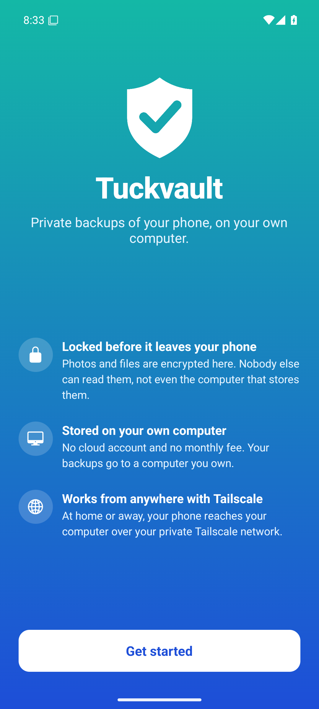
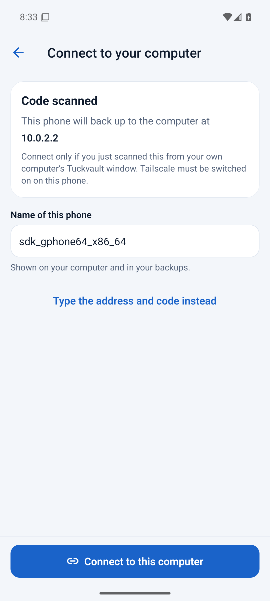
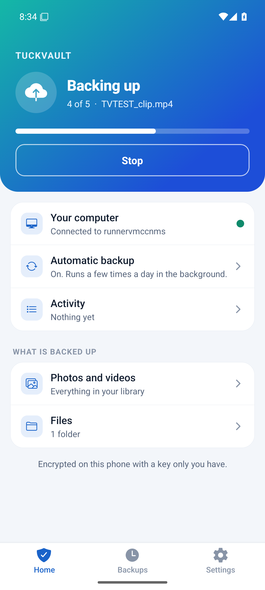
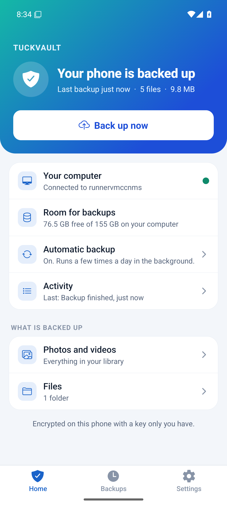
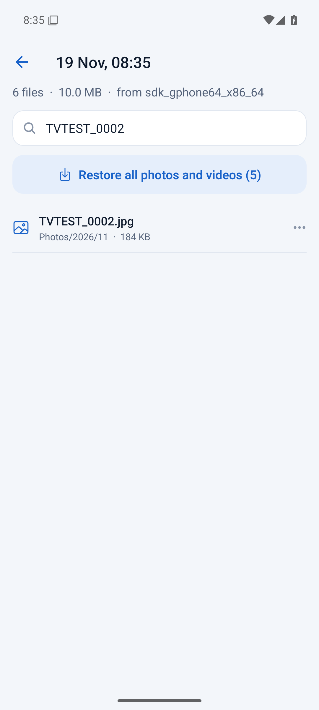
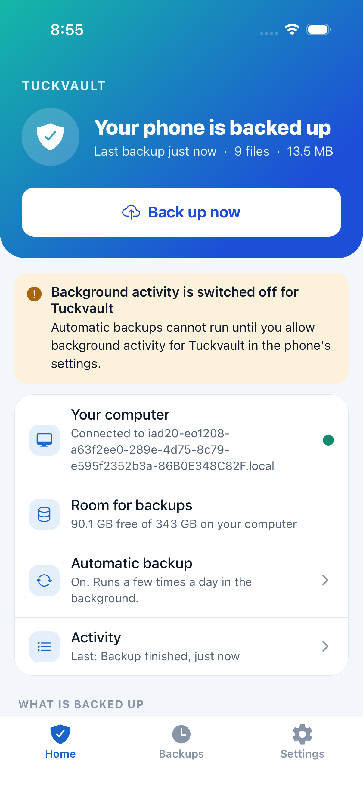
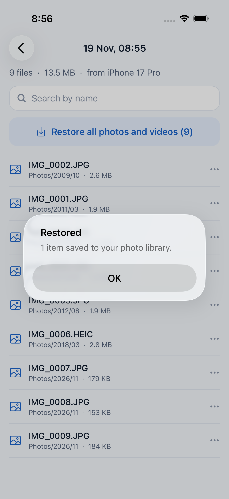

# Tuckvault for phones

The Tuckvault app backs up the photos, videos and files on an Android phone or
iPhone to a computer you own. Everything is encrypted on the phone before it
is sent, in the same format the PC program uses, and travels over your private
[Tailscale](https://tailscale.com) network, so it works at home and away.

<p>





</p>

## What you need

- A computer that stays on, running Tuckvault 1.5 or newer (Windows or Linux).
  It can store the phone's backups itself or pass them on to another machine
  over SSH, exactly like its own backups.
- Tailscale on that computer and on the phone, signed in to the same account.
- The app: an APK for Android is attached to each
  [mobile release](https://github.com/karacanil/tuckvault/releases). For iPhone
  see [iPhone](#iphone) below.

To install the APK, open it on the phone and allow your browser or file app to
install apps when Android asks. Every release is signed with the same key;
its certificate's SHA-256 is

```
e418fa07645b33f956f34200d4cab18d29d84c6722975ae78b69a907138a97c3
```

and `apksigner verify --print-certs <apk>` shows it, if you want to check that
a download is genuine.

## Setting it up

On the computer:

1. Open Tuckvault and go to the **Phones** tab.
2. Tick **Accept backups from phones**. Windows may ask once whether Python (or
   Tuckvault) may accept connections; allow it for private networks.
3. Click **Pair a phone…**. It shows a square code to scan, and below it an
   address and a short code for typing instead.

Without the window, the same three steps are:

```
tuckvault phone enable
tuckvault phone pair
```

On the phone:

1. Point the phone's camera at the square code and open the link it offers.
   Tuckvault opens with the computer's address filled in.
2. Check that address and tap **Connect to this computer**. (Or choose **Get
   started** in the app and type the address and the short code.)
3. Save the **recovery key** it shows. It is the only way to open the backups
   if the phone is lost. Nobody can reset it.
4. Choose what to back up, then tap **Back up now**.

After that the phone backs up by itself a few times a day, when the computer
can be reached (and, by default, only on Wi-Fi).

## What is backed up

| | Android | iPhone |
|---|---|---|
| Photos and videos | Everything in the library, as the camera saved it, including the location inside each photo | Everything in the library, in its current (edited) form |
| Files | Any folders you choose | Whatever you put in the **Tuckvault** folder in the Files app (On My iPhone) |

Each backup is a complete picture of those things at that moment. Later
backups only send what is new or changed, and when nothing changed no new
backup is written at all. By default the newest 30 backups are
kept, so a photo you delete from the phone stays restorable until 30 newer
backups exist; you can also keep everything.

## Getting things back

- **On the phone:** open a backup on the Backups tab, then save a photo back
  to the library, share any file, or restore all photos and videos at once.
- **On a new phone:** install the app, pair it, and choose **I already have a
  recovery key**. The new phone sees the old phone's backups and continues them.
- **On the computer:** Phones tab, **Restore a phone's backup to this
  computer…**, or `tuckvault phone restore <folder>`. It asks for the recovery key.

## Notifications

The app tells you when a backup stored new files, when a backup has a problem
(at most once a day for automatic runs), and when there has been no backup for
a number of days you choose. All three can be switched off in Settings.

## How it is protected

- The phone makes its own 256-bit key. It never leaves the phone except as the
  recovery key you save yourself. The computer stores only unreadable data,
  including file names.
- Pairing gives the phone its own secret. Every request is signed with it
  (HMAC-SHA256 over the method, address, time and content), so the secret is
  sent once, at pairing, and never again.
- The service listens only on the computer itself and on its Tailscale
  address, never on the local network or the internet.
- Every stored piece is named by its SHA-256. The computer refuses pieces that
  arrive damaged, the phone checks every byte it restores, and **Check all
  backups now** re-reads everything stored.

See [SECURITY.md](../SECURITY.md) for the limits.

## Limits of version 1.0

- **Time in the background is short.** Android gives an automatic run a few
  minutes, iOS well under a minute. A first backup of a large library will not
  finish that way: open the app and leave it open until it is done. What was
  sent is never sent twice.
- **Live Photos** are backed up as their still picture; the short video that
  belongs to them is not.
- **Photos kept only in iCloud** are fetched from iCloud when they are backed up,
  which needs a connection and can be slow.
- Restoring a photo that is still on the phone makes a second copy of it.
- Two phones that share a recovery key share one set of backups. Each phone's
  "newest 30" is counted on its own, so they never push out each other's, but
  data nothing refers to is only cleaned up once the other phone has been
  quiet for two weeks.
- If you allow access to selected photos only, those are backed up as their
  own item ("Photos (selected)") and never replace backups of the whole library.

## iPhone

On every change this repository's CI builds the iOS app and runs it in an
iPhone simulator against the real PC program: it sets itself up, backs up the
photo library, restores a photo on the phone, and the PC then restores the
backup with the recovery key and compares it byte for byte
(`mobile/e2e/run_ios.sh`). Its storage code is also tested against the same
vectors as Android. The same run is repeated with the app inside Expo Go.
Automatic background backups cannot be tried in a simulator.

<p>


</p>

Apple only lets apps onto an iPhone when they are signed with an Apple
developer account, so there is no ready-to-install download. There are two
ways to use it on your own iPhone.

### Inside Expo Go (no Mac, no developer account)

[Expo Go](https://apps.apple.com/app/expo-go/id982107779) is a free app from
the App Store that runs Expo projects. Tuckvault runs inside it, served from
your computer:

1. On the iPhone, install Expo Go and Tailscale and sign in to both.
2. On the computer, in `mobile/`: `npm ci` once, then `npm run go`. The first
   time it asks you to sign in to Expo; use the same account as in Expo Go.
3. Scan the code it shows with the iPhone's camera. Tuckvault opens in Expo Go.
4. To pair by scanning there, make the pairing code open Expo Go instead of
   the installed app (the address is the one `npm run go` printed):
   `tuckvault phone pair --qr pair.png --link-prefix exp://ADDRESS:8093/--/`

Everything is encrypted and stored exactly as with the installed app, and the
backups are the same ones (the storage format is done in TypeScript there,
with the phone's own AES and SHA-256, and is tested against the same vectors).
What is different inside Expo Go:

- No automatic backups: Expo Go cannot run in the background. Open the app
  and tap **Back up now**.
- No Tuckvault folder in the Files app, so photos and videos only.
- The computer running `npm run go` must be reachable to open the app.
- On Android, Expo Go may not see the photo library; use the APK there.

### Built with Xcode

With a Mac with Xcode and a (free or paid) Apple developer sign-in you get
the full app:

```
cd mobile
npm ci
npx expo run:ios --device --configuration Release
```

## Building and testing

```
cd mobile
npm ci
npm run typecheck
npm test                 # the backup engine against a real `tuckvault serve`, restored by the PC program
npx expo prebuild --platform android --no-install
cd android
./gradlew :tuckvault-core:testDebugUnitTest      # the Kotlin storage code against the PC's vectors
./gradlew :app:assembleRelease
```

`python mobile/e2e/run_android.py --apk <apk>` drives the installed app on an
emulator from first start to a restored photo, and compares what the PC
restores with what was put on the phone, byte for byte.

With `--expo-go exp://127.0.0.1:<port>` instead of `--apk` the same script
drives the app inside Expo Go (`npx expo start --go` running, the port passed
on with `adb reverse`).

`python3 tools/phone_over_network.py http://<address>:8743 <code>` plays a phone
from a second computer: it pairs, sends an encrypted backup and prints what the
receiving computer needs to restore and compare it. Use it to try the service
across a real network link (a Tailscale address, for example) without a phone.

Layout:

| Path | What |
|---|---|
| `src/lib/engine.ts`, `client.ts` | Backup, restore, check and clean-up; talking to the computer. No phone code, so they are tested on a PC |
| `src/lib/sources.ts`, `runner.ts`, `background.ts`, `notify.ts` | Finding photos and files, running backups, automatic runs, notifications |
| `src/app/`, `src/ui/` | The screens |
| `modules/tuckvault-core/` | The native module: storage format and file reading in Kotlin and Swift |
| `src/lib/native.ts`, `jscore.ts`, `vaultjs.ts` | The same in TypeScript, used where the native module is absent (Expo Go) |
| `test/`, `e2e/` | Tests |
